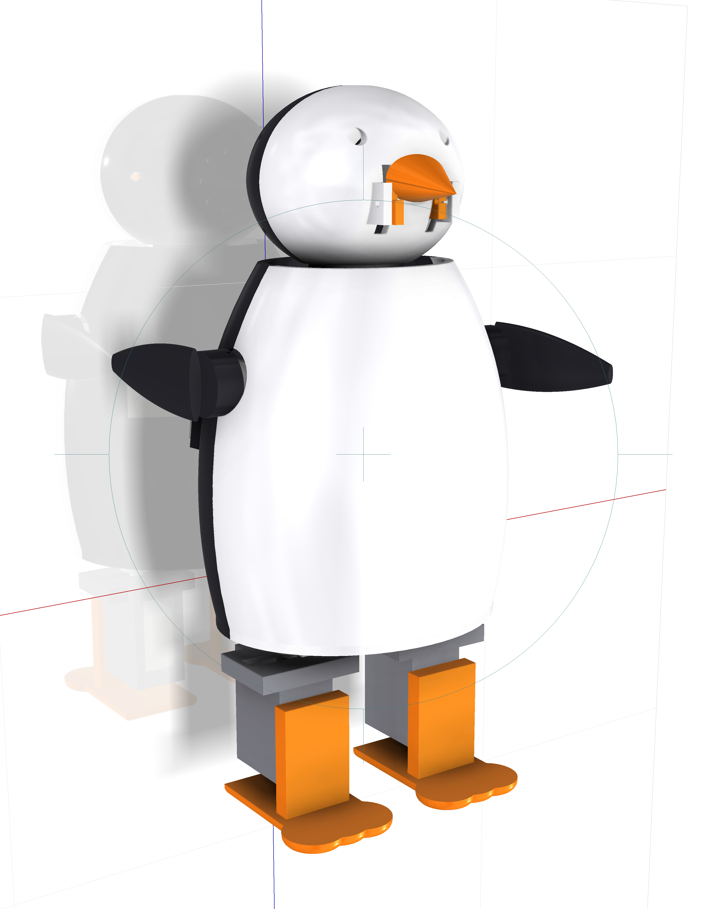
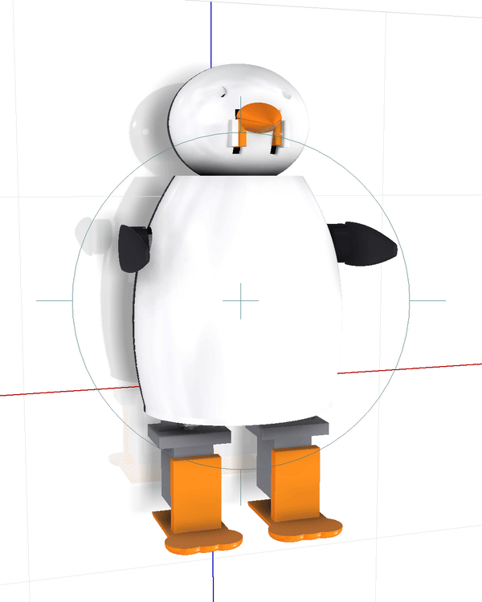
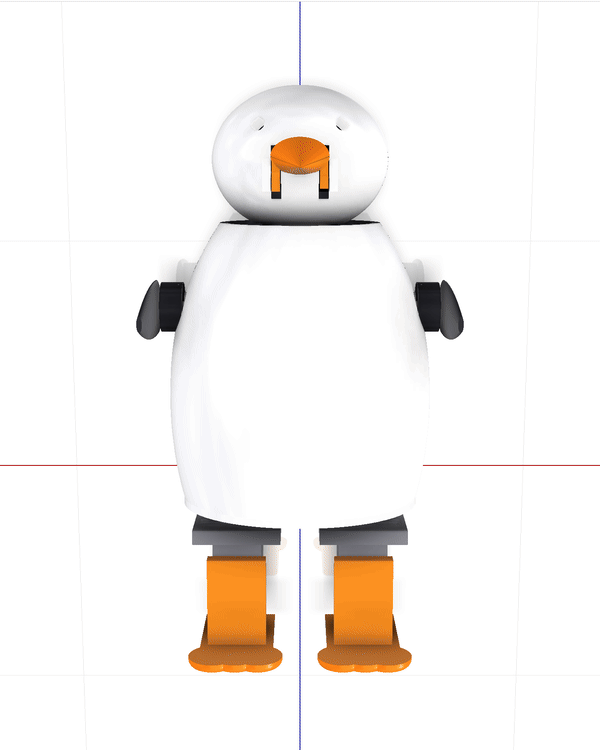

# Robot penguin

A 23 cm desk penguin that waddles, talks, pulls faces, dances to whatever is
playing, and learns how to react to the people around it.

<p align="center">
  
</p>

Seven servos, an ESP32-S3, and a 580 g shell that was designed, simulated and
tuned as one thing — the simulation is built from the CAD, and the firmware's
motion tables are generated from the simulation, so what you print is what was
tested.

<p align="center">
  
  &nbsp;
  
</p>

> ### Status: designed and simulated, not yet built
>
> Every number in this repository comes from CAD or from a physics simulation.
> **Nothing here has been tested on physical hardware yet.** The first parts
> went on the printer in October 2026.
>
> That makes this a complete, honest design package — fully parametric CAD,
> print-verified STLs, firmware that compiles, and a simulation you can run
> today — but it is *not* a proven build. Expect the sim-to-real gap to bite,
> especially on the gait. If you build one, please open an issue and say what
> broke.

**Licence:** [MIT](LICENSE) for the software, [CC BY-SA 4.0](LICENSE-HARDWARE)
for the hardware design and docs.

---

## Read these first

| | |
|---|---|
| **[docs/HOW_IT_WORKS.md](docs/HOW_IT_WORKS.md)** | The robotics and the learning software, explained with this robot's numbers. Start here. |
| **[docs/BUILD_LOG.md](docs/BUILD_LOG.md)** | Everything that happened and everything that went wrong, in order. |
| **[docs/COMPONENTS.md](docs/COMPONENTS.md)** | What every servo and board does, including the two on the back. |
| **[docs/BOM.md](docs/BOM.md)** | What to order, with the dimension the CAD assumes. |
| **[docs/SHOPPING_LIST.md](docs/SHOPPING_LIST.md)** | The same thing as a one-page buying list, in order, with the hard dimensions flagged. |
| **[docs/ASSEMBLY.md](docs/ASSEMBLY.md)** | Build order, because several things become unreachable once something else is in. |
| **[docs/ONDEVICE_AI.md](docs/ONDEVICE_AI.md)** | The three-tier AI, and the honest answer about an LLM on an ESP32. |
| **[docs/SELF_RIGHTING.md](docs/SELF_RIGHTING.md)** | Why it cannot get up off the floor, with the full dataset. |
| **[CAD/REPORT.md](CAD/REPORT.md)** | The CAD model: parts, masses, interference, parameters. |

## To print

`CAD/exports/stl_print/` — 14 parts, already rotated to the recommended print
orientation, sitting on Z=0, centred, and each verified watertight and within
**0.37%** of the CAD volume. Drop them into the slicer as they are. Settings
are in [docs/SHOPPING_LIST.md](docs/SHOPPING_LIST.md).

`CAD/exports/stl_assembled/` — the same parts in their as-designed positions,
for checking fit in a viewer.

`CAD/exports/penguin.stp` — STEP export of the whole assembly, if you would
rather not open Inventor.

Total printed mass is about **160 g** at 20% infill. The largest footprint is
the body shells at 106 × 115 mm, so a 180 mm bed is plenty.

---

## Layout

```
CAD/          Inventor model, parameter spreadsheet, STL/STEP exports, renders
sim/          PyBullet simulation, controllers, and the searches that tuned them
matlab/       Simscape Multibody cross-check and the closed-form stability map
brain/        Host-side: the LLM, the learned memory, beat detection, beak sync
firmware/     ESP32-S3 firmware + the generator that writes its motion tables
docs/         The documents above
tools/        check_parity.py - proves host and firmware agree bit for bit
```

## The pipeline, and why it is one pipeline

```
   Inventor  --masses, inertias, joint axes-->  mass_properties.json
       |                                               |
       +--STL meshes------------------------------+    |
                                                  v    v
                                            sim/penguin.urdf
                                                  |
                        +-------------------------+------------------+
                        v                         v                  v
                 PyBullet (tuning)        Simscape (check)    behaviours.py
                        |                                            |
                        +----tuned parameters----+    +--keyframes---+
                                                 v    v
                                      firmware/.../motions.h  (generated)
```

Nothing in that chain is retyped by hand, which is the point: a dimension change
in the spreadsheet propagates to the printed part, the simulated robot and the
firmware's motion tables without anyone remembering to update three places.

Every dimension in the CAD comes from a named parameter in
`CAD/penguin_params.xlsx`, and every sketch is fully constrained. Change
`bodyW35` and the whole robot rebuilds.

---

## Running it

**Simulation** (needs `pip install pybullet numpy`)

```bash
cd sim
python penguin_env.py        # stand it up and print what it is doing
python terrain_test.py       # walk it on hard floor and three carpets
python gait_refine.py        # re-tune the gait
```

**The brain** (needs `ANTHROPIC_API_KEY` in your environment)

```bash
cd brain
pip install anthropic websockets numpy
python run.py                # type at it; /startled /tickled /music for events
```

**Firmware** (needs [PlatformIO](https://platformio.org/))

```bash
cd firmware
python export_motions.py     # regenerate motion tables from the simulation
cd penguin && pio run -t upload
```

Set your WiFi credentials in `firmware/penguin/src/main.cpp` first — they are
`CHANGE_ME` placeholders.

**Checks**

```bash
python tools/check_parity.py             # host and firmware fingerprints agree
cd brain && python test_learning.py      # does it actually learn
```

---

## Where it stands

**Works and is measured — in simulation:** stands with even foot loads (CoM
105 mm, 3.6/4.1 N); walks at **9.8 mm/s with 18.6 mm of ground clearance** and
does not fall; **30 behaviours** (11 emotes, 16 tricks, 3 beat-locked dances)
all verified stable, with a median of 3.3% of the time at the servo limit;
survives a **1.4 N shove from 7 of 8 directions**; stands on 4 mm and 8 mm
carpet pile; beak tracks speech; learns offline answers to **55% of what a
regular owner says at 95% precision** in 12 KB of flash.

**Verified in CAD:** 29 occurrences, 54 constraints, 579.7 g, zero interference
across every pair; all 14 STLs watertight and within 0.37% of the CAD volume.

**Firmware:** compiles clean for the ESP32-S3 (RAM 50.9%, Flash 40.2%). Never
flashed to a board.

**Does not work:** it cannot get up off the floor, and **longer flippers do not
fix it** — six controller architectures, five flipper lengths, ~5,500 simulated
attempts, full data in [docs/SELF_RIGHTING.md](docs/SELF_RIGHTING.md). A
dedicated tail prop was designed, simulated and rejected too; the apparent
six-fold improvement turned out to be the prop's resting angle rather than any
righting motion. It instead asks to be picked up, which the firmware does
automatically after one attempt.

**Untested, honestly:** walking on a real floor; the carpet results (the contact
model is not trustworthy enough to believe them); the reaction signals
(laughter via microphone, a pat via the IMU) are written but never validated;
the optional on-device language model is specified but not built.

---

## Where it could go next

Roughly in order of effort, and all gated on the robot walking on a real floor
first:

- **Re-tune the gait on hardware.** The only genuinely load-bearing item.
- **Eyes** — two GC9A01 round LCDs. The biggest character gain per pound in the
  whole project, and the SPI pins are free.
- **A neck yaw servo**, so it can look at you rather than only where its feet
  point.
- **A camera.** The S3 drives an OV2640 fine; face detection would make
  "remembers who you are" real rather than text-matched.
- **On-robot gait learning** — CMA-ES over ~10 gait parameters with an
  IMU-derived reward. This dissolves the carpet problem by definition, because
  the robot tunes itself on whatever surface it is actually standing on.
- **Self-righting, properly.** This needs a different body — wider feet with a
  lower centre of mass, or a flipper strong enough to push. Not a patch.

---

## Licence

| | |
|---|---|
| **Software** — `sim/`, `brain/`, `firmware/`, `tools/`, `matlab/` | [MIT](LICENSE) |
| **Hardware and docs** — `CAD/`, `docs/`, the renders | [CC BY-SA 4.0](LICENSE-HARDWARE) |

Build it, remix it, sell it if you like. If you distribute a modified
*hardware* design, share it back under the same licence and credit the
original.

No warranty of any kind. This involves lithium cells, a 3 A rail and moving
parts, and none of it has been tested on a real robot yet. You are responsible
for the safety of anything you build.
